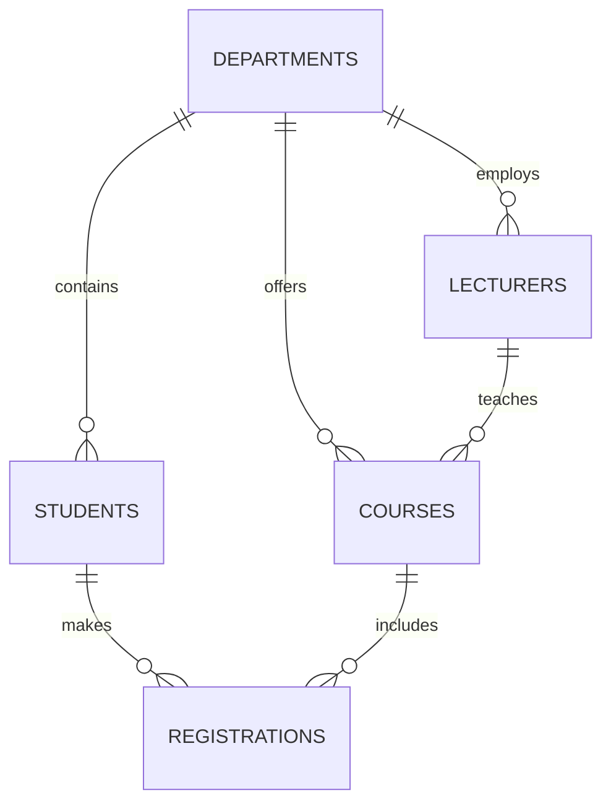

# Database Design Notes
Entities: Departments, Students, Lecturers, Courses, Registrations.
Relationships: Department has many students, lecturers, courses; Lecturer teaches many courses; Student and Course are many-to-many through Registrations.
Normalisation: departments, lecturers, students and courses are separated into entity tables; the associative Registrations table holds term-specific student-course enrollment and grade. Non-key attributes depend on their table key. Unique constraints preserve key business rules.
ERD (Mermaid):

